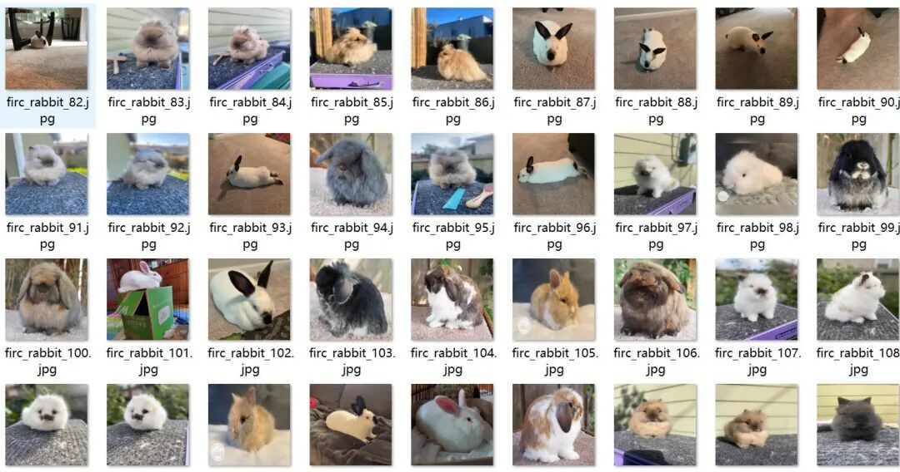
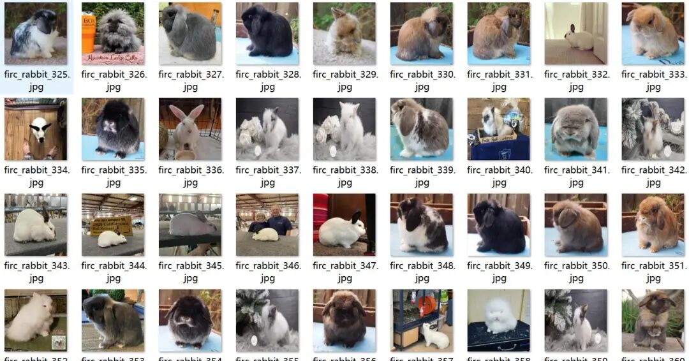
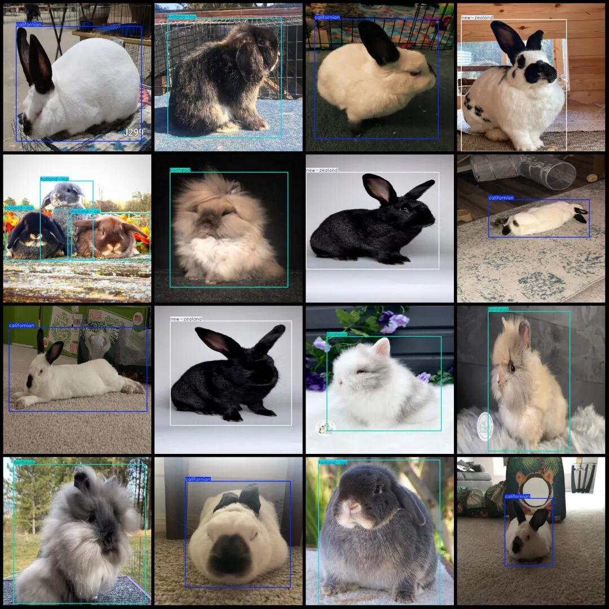
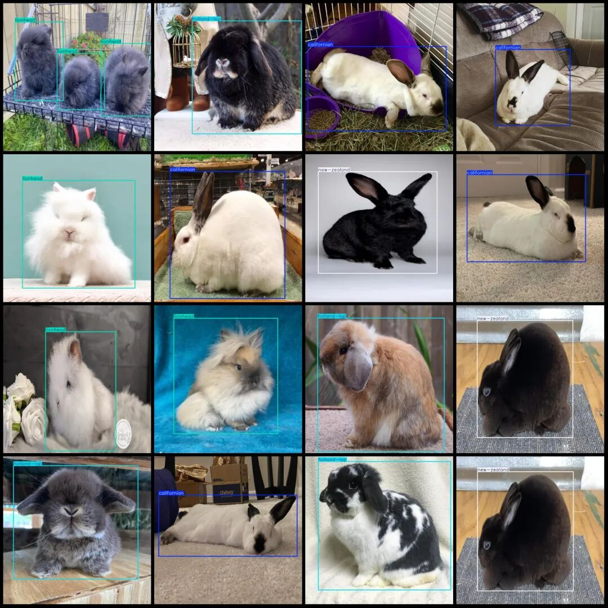

# Rabbit Variety Detection Dataset VOC+YOLO format with 3100 images in 4 categories

Dataset format: Pascal VOC format + YOLO format (txt file without split path, only containing jpg images and corresponding VOC format xml files and yolo format txt files)

Number of images (number of jpg files): 3100

Number of annotations (number of xml files): 3100

Number of annotations (number of txt files): 3100

Labeling category count: 4

Label category names (note that the order of yolo format categories does not correspond to this, but is based on the classes.txt in the labels folder): ["californian", "holland-lop", "lionhead", "new-zealand"]

Number of boxes labeled in each category:

California (California Rabbit) frame count = 862

Holland Lop (Dutch Lop) frame count = 808

Lionhead (lion head rabbit) frame count = 867

New Zealand (New Zealand rabbit) frame count = 777

Total frame count: 3314

Number of images per category:

California (Calf) occupies the number of images = 775

Holland Lop (Dutch Lop) has 775 images.

Lionhead (Siamese rabbit) owns 775 images.

New Zealand (New Zealand rabbit) has 775 images.

Image resolution: 640x640

Using labelImg:

Annotation rules: Draw a rectangle around the category.

Important Notice: The dataset does not have separate training, validation, and test sets; you need to partition them yourself.

Special : This dataset does not guarantee the accuracy of the trained models or weight files.

Image Preview:

Annotation example:

## Payment

Here is a pay link on Stripe ( https://buy.stripe.com/3cs8yP7sY87d0vu9AB ). Please contact me lonlonago@foxmail.com after funding $89, and I will send you a complete data files , thank you!

